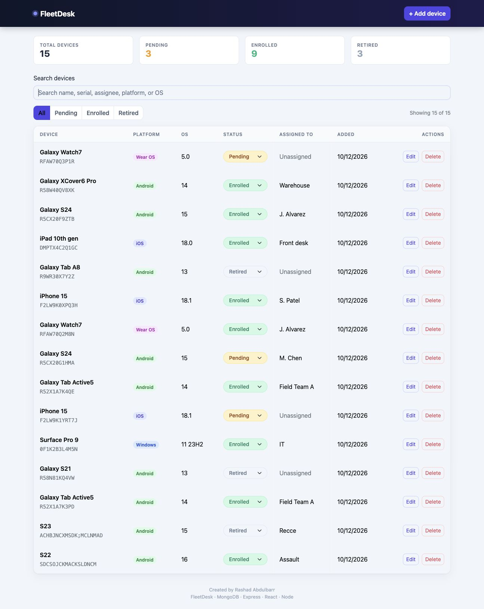
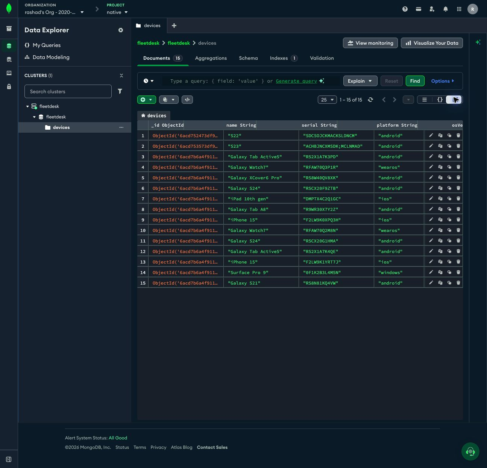
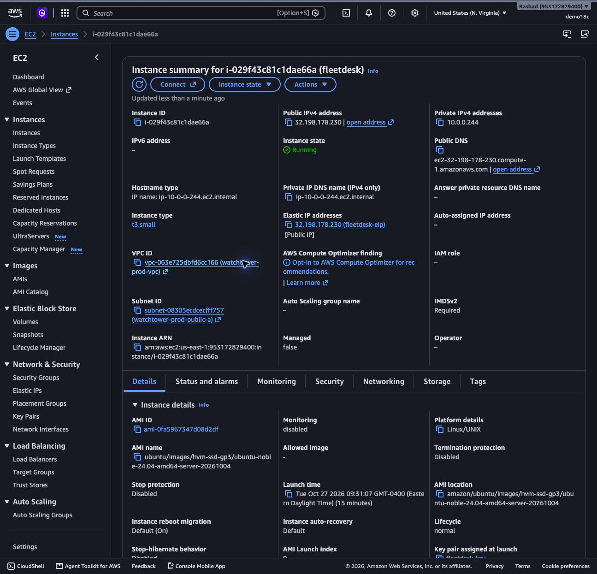
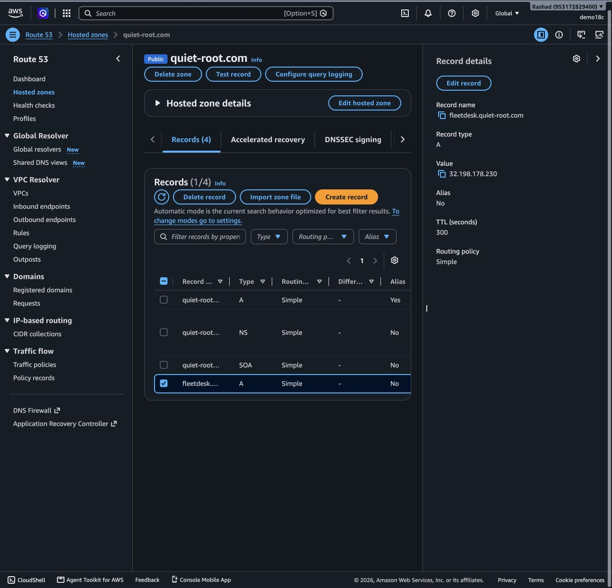
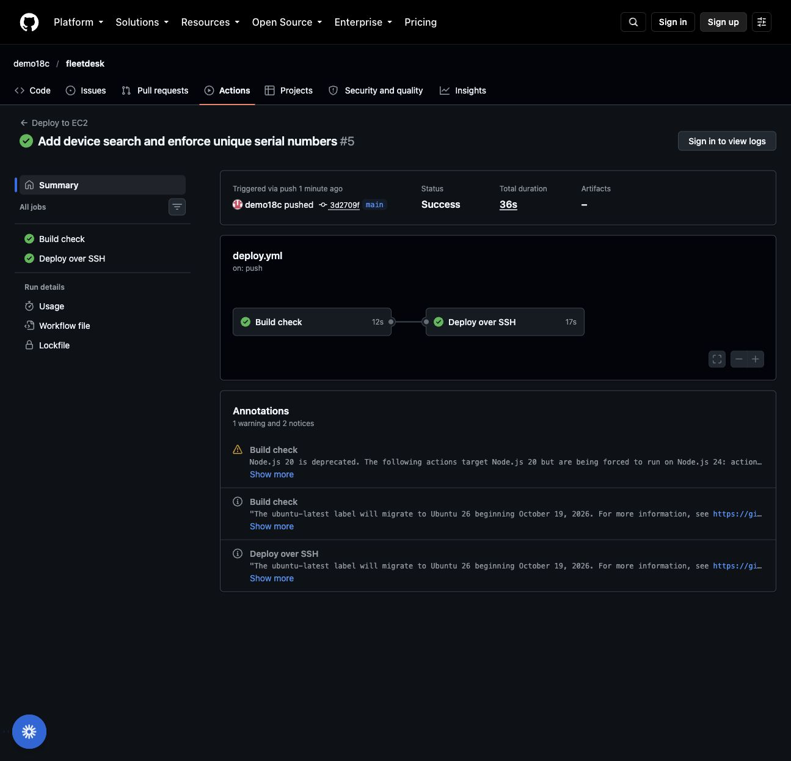

# FleetDesk

A device fleet inventory built on the **MERN** stack: **M**ongoDB Atlas, **E**xpress, **R**eact, **N**ode.
Created by **Rashad Abdulbarr** for **ITMD 504 — Programming and Application Foundations**.

List, search, add, edit, and remove managed devices from a single page.

[Assignment requirements and evidence](docs/submission.md) · [Verification results](docs/verification.md)

| | |
|---|---|
| **Live app** | https://fleetdesk.quiet-root.com |
| **Source** | https://github.com/demo18c/fleetdesk |
| **User stories** | [docs/user-stories.md](docs/user-stories.md) |



## Frameworks and services

| Layer | Technology | Purpose |
|---|---|---|
| Frontend | React 18 + Vite | Single-page UI, hot reload in dev, static build for prod |
| UI kit | Bootstrap 5 via react-bootstrap | Navbar, table, modal form, badges, responsive grid |
| Backend | Node 22 + Express 4 | REST API, serves the built React app in production |
| ODM | Mongoose 8 | Schema, validation, and queries against MongoDB |
| Database | MongoDB Atlas (M0 free tier) | Cloud-hosted `fleetdesk` database, `devices` collection |
| Hosting | AWS EC2 (Ubuntu 24.04) + Elastic IP | Runs the Node process under PM2 |
| TLS / proxy | Caddy | Automatic Let's Encrypt HTTPS, reverse proxy to port 5001 |
| DNS | AWS Route 53 | Public hostname → Elastic IP |
| CI/CD | GitHub Actions | Build check, then SSH deploy on every push to `main` |

## Architecture

```
Browser ──HTTPS──▶ Route 53 ─▶ Elastic IP ─▶ Caddy :443 ─▶ Express :5001 ─▶ MongoDB Atlas
                                                     │
                                                     └─ serves client/dist (React build)
```

One EC2 instance hosts both the API and the React build, so the browser talks to a single origin.
In development, Vite serves the React app on `:5173` and proxies `/api/*` to Express on `:5001`.

## API

Base path: `/api/devices`

| Method | Path | Body | Response |
|---|---|---|---|
| GET | `/api/devices` | — | `200` array of devices, newest first |
| POST | `/api/devices` | `{ name, serial, platform, osVersion, status, assignedTo, notes }` | `201` created device |
| PUT | `/api/devices/:id` | any subset of the fields above | `200` updated device, `404` if not found |
| DELETE | `/api/devices/:id` | — | `204`, `404` if not found |

Validation errors return `400 { "error": "..." }`. Duplicate serials on creation or update return `409` with a clear message. A database unique index enforces this even for concurrent requests. The server waits for index initialization before accepting traffic.

Search is case-insensitive, ignores surrounding whitespace, and matches device name, serial, assignee, platform (including “Wear OS”), or OS version. It combines with the existing status filters and does not modify stored records.

**Device schema** (`server/models/Device.js`)

| Field | Type | Rules |
|---|---|---|
| name | String | required, ≤ 80 chars |
| serial | String | required, trimmed, stored uppercase, unique |
| platform | enum | `android` · `ios` · `wearos` · `windows` |
| osVersion | String | optional |
| status | enum | `pending` · `enrolled` · `retired` |
| assignedTo | String | optional |
| notes | String | optional |
| createdAt / updatedAt | Date | automatic |

### CORS

The server only accepts requests from the web app's own origin:

```js
app.use(cors({ origin: process.env.CLIENT_ORIGIN }));
```

`CLIENT_ORIGIN` is `http://localhost:5173` in development and `https://fleetdesk.quiet-root.com` in production.

## Database



MongoDB Atlas, cluster `fleetdesk`, database `fleetdesk`, collection `devices`. The documents above
correspond to the rows shown in the app screenshot.

## Running locally

```bash
git clone https://github.com/demo18c/fleetdesk.git
cd fleetdesk
npm install
cp .env.example .env     # then set MONGODB_URI to your Atlas connection string
npm run dev              # API on :5001, React on :5173
```

Open http://localhost:5173.

## Deployment

### Infrastructure

- **EC2** t3.small, Ubuntu 24.04, security group allows 22 (admin IP), 80 and 443 (public).
- **Elastic IP** so the address survives restarts.
- **Route 53** A record → Elastic IP.
- **Caddy** terminates TLS and proxies to the Node process (`deploy/Caddyfile`).
- **PM2** keeps the Node process alive and restarts it on reboot (`deploy/ecosystem.config.cjs`).

First-time server setup is scripted in `deploy/setup-ec2.sh`.





### Continuous deployment

Every push to `main` triggers `.github/workflows/deploy.yml`:

1. **Build check** — `npm ci && npm run build` on a GitHub runner. A broken build never reaches the server.
2. **Deploy** — the runner SSHes into the EC2 instance (host and private key stored as GitHub secrets)
   and runs `deploy/deploy.sh`, which pulls `main`, installs dependencies, rebuilds the React app,
   and restarts the PM2 process.



### Secrets

Nothing sensitive is committed. The Atlas connection string lives only in `.env` on the developer
machine and on the server. The SSH deploy key lives only in GitHub Actions secrets.

## Project structure

```
server/            Express API
  index.js         app setup, CORS, static serving, Mongo connection
  models/Device.js Mongoose schema
  routes/devices.js  GET / POST / PUT / DELETE handlers
client/            React app (Vite)
  src/App.jsx      state + CRUD handlers
  src/api.js       fetch wrapper for the four endpoints
  src/components/  DeviceTable, DeviceModal
  src/styles.css   theme overrides on top of Bootstrap
deploy/            Caddyfile, PM2 config, EC2 setup + deploy scripts
.github/workflows/ CI/CD pipeline
docs/              user stories, screenshots
```
