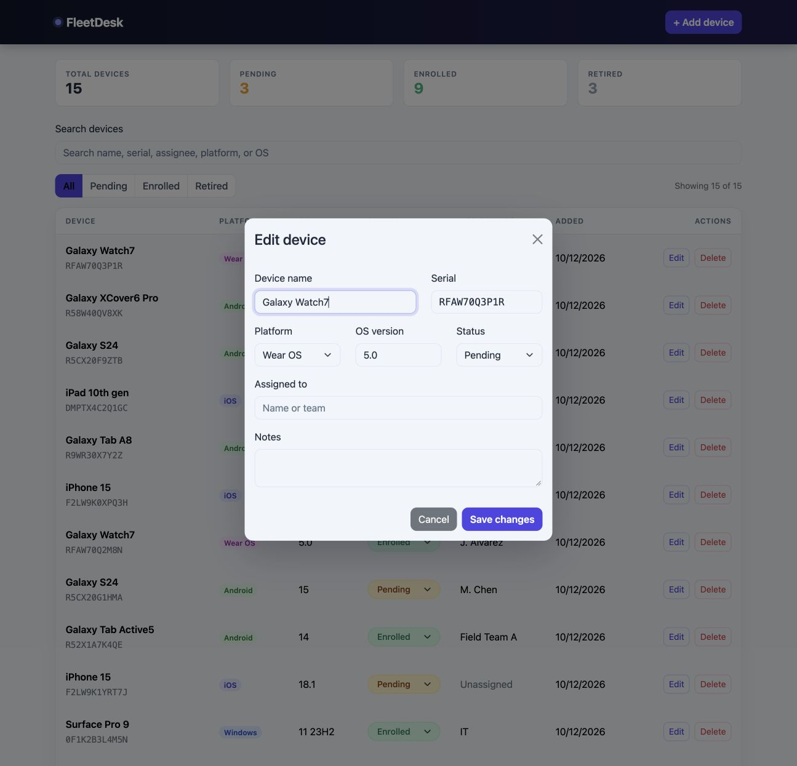
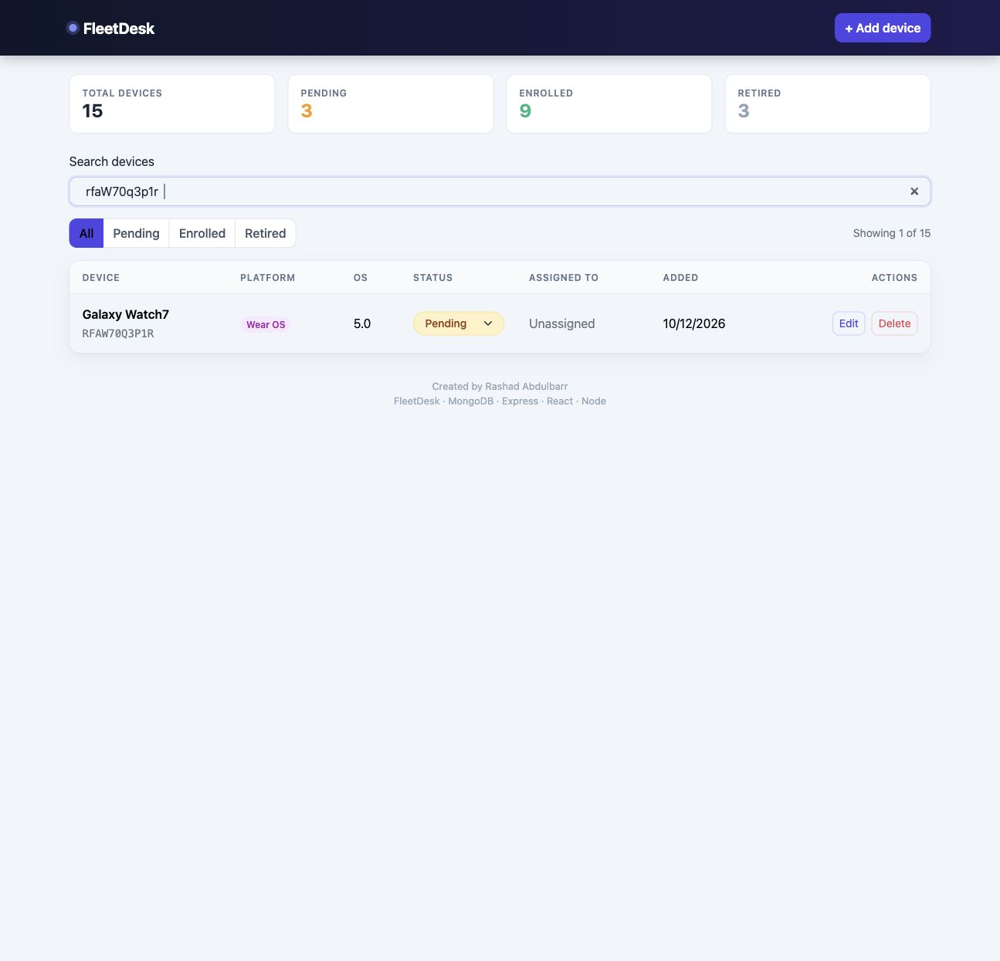

# FleetDesk — ITMD 504 final project

**Author:** Rashad Abdulbarr  
**Course:** Programming and Application Foundations  
**Evidence reviewed:** October 27, 2026

## Required URLs

- Functional cloud application: https://fleetdesk.quiet-root.com
- Source control: https://github.com/demo18c/fleetdesk

## Purpose and requirements

FleetDesk supports a small IT or field-support team managing phones, tablets, watches, and Windows devices. Administrators need to list inventory, register devices, update assignments and enrollment status, search records, and remove retired inventory. The [user stories](user-stories.md) contain acceptance criteria for these workflows.

## Transcript requirements mapped to implementation

| Requirement | Implementation and evidence |
|---|---|
| Public functional cloud URL | HTTPS app on AWS EC2; application screenshot below |
| Frontend frameworks and styling | React, Vite, Bootstrap and custom CSS in `client/src` |
| Server logic and client API consumption | Express routes in `server/routes/devices.js`; browser fetch functions in `client/src/api.js` |
| Database and matching records | MongoDB Atlas `fleetdesk.devices`; screenshot below shows the same names and serials as the application |
| Dynamic retrieval and updates | GET, POST, PUT and DELETE; edit modal and inline status control |
| Source control | Public repository linked above; incremental commits |
| User requirements | Ten documented user stories with acceptance criteria |
| Continuous deployment | GitHub Actions builds on push to main, then deploys over SSH, rebuilds on EC2 and restarts PM2 |
| User experience | Responsive table, platform badges, status filters, search, required fields, error feedback and delete confirmation |

## Architecture and data handling

The browser calls `/api/devices` on the same HTTPS origin. Caddy proxies to Express, which serves both the React build and REST API. Express uses Mongoose to read and write the MongoDB Atlas `devices` collection. A device has a name, serial, platform, OS version, enrollment status, assignee, notes and creation/update timestamps. No relational tables are required for this document database.

Serials are trimmed and converted to uppercase before storage. A unique database index prevents duplicate serials on both creation and update, including simultaneous requests. Conflicts return HTTP 409 and a readable message inside the form. Other schema validation errors return HTTP 400. The server waits for index initialization before opening its port.

Search filters loaded records without changing the database, ignores case and surrounding whitespace, and works together with the status filter. It searches name, serial, assignee, platform and OS version.

CORS uses `CLIENT_ORIGIN`; database credentials stay in environment files outside source control. CORS is a browser policy, not authentication. This is a public coursework demonstration with public inventory editing, not a production MDM service or a device-control agent.

## Application and database evidence

Match `Galaxy Watch7` / `RFAW70Q3P1R`, `Galaxy XCover6 Pro` / `R58W40QV8XK`, and `Galaxy S24` / `R5CX20F9ZTB` between the app and Atlas screenshots. The app sorts newest first; Atlas's table order differs. Dates in the app use the browser timezone, while Atlas stores UTC timestamps.

## Continuous deployment evidence

[Successful search/unique-serial deployment](https://github.com/demo18c/fleetdesk/actions/runs/40514259850). Both Build check and Deploy over SSH succeeded.

## Reviewer walkthrough

1. Open the public app; the launch screen clears automatically.
2. Search for `RFAW70Q3P1R`; one Galaxy Watch7 should appear. Search ignores letter case.
3. Choose Enrolled while that search is active; no records match. Return to All and clear search to restore the 15-device view.
4. Open Edit to inspect the pre-filled fields. Cancel leaves data unchanged.
5. To test duplicate prevention without creating a record, use Add device with a name and existing serial `RFAW70Q3P1R`. The form should explain that the serial already exists. Cancel afterward.
6. For CRUD demonstration, create a clearly labeled demo device with a new serial, edit it, and refresh to confirm persistence. Keep demonstration records separate from the original inventory.

## Evidence still requiring AWS access

An EC2 console screenshot and optional Route 53 DNS screenshot are pending AWS sign-in. AWS CLI credentials were expired and the browser presented its sign-in page on October 27. These screenshots have not been fabricated or represented as captured. Cloud deployment is independently evidenced by the working public app and successful SSH deployment workflow. Keep the app running through the instructor's grading period; the supplied transcript does not specify an exact duration.

See [verification results](verification.md) for completed checks.
