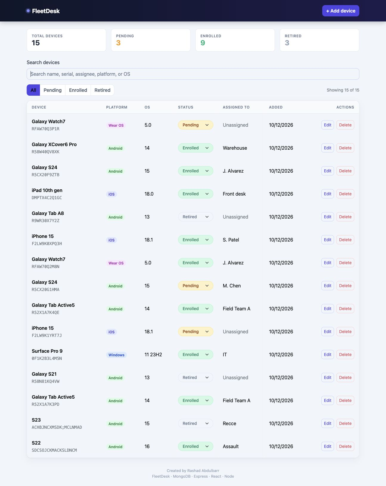
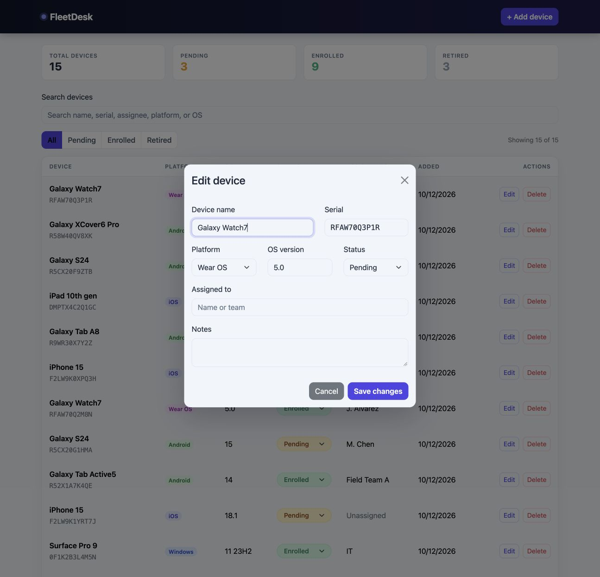
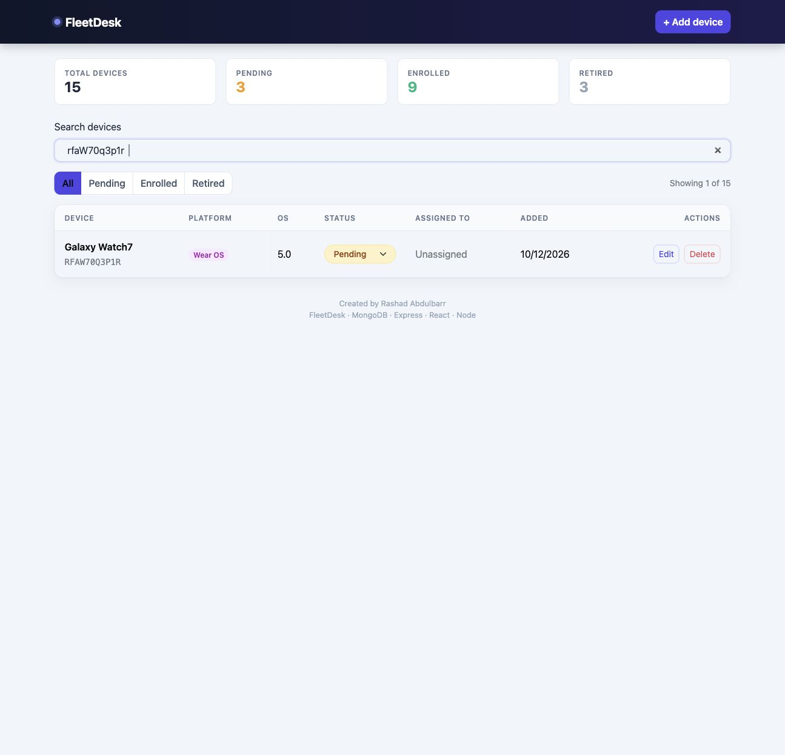
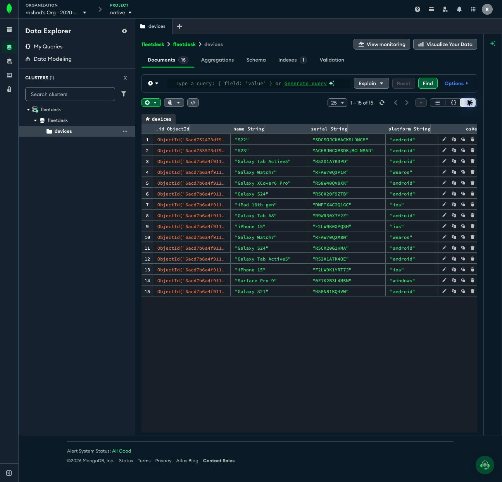
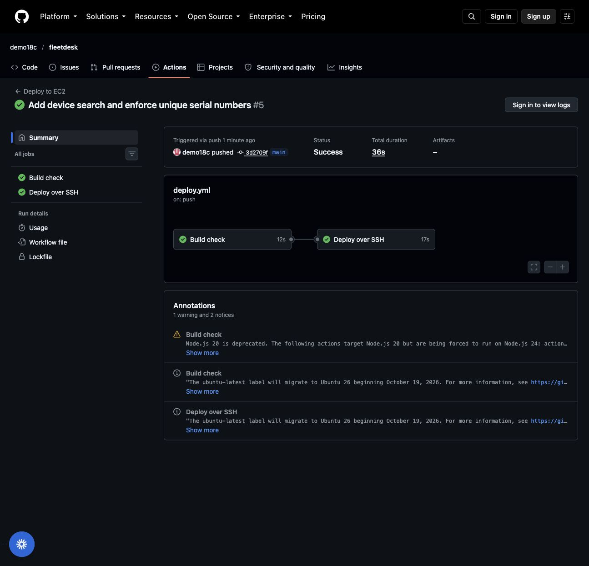
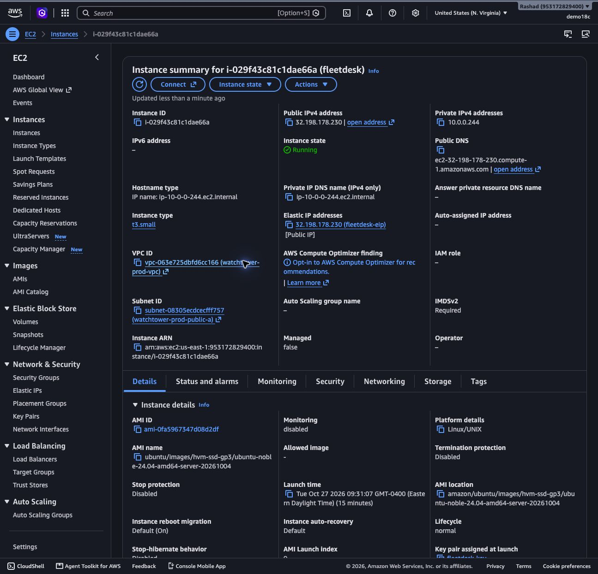
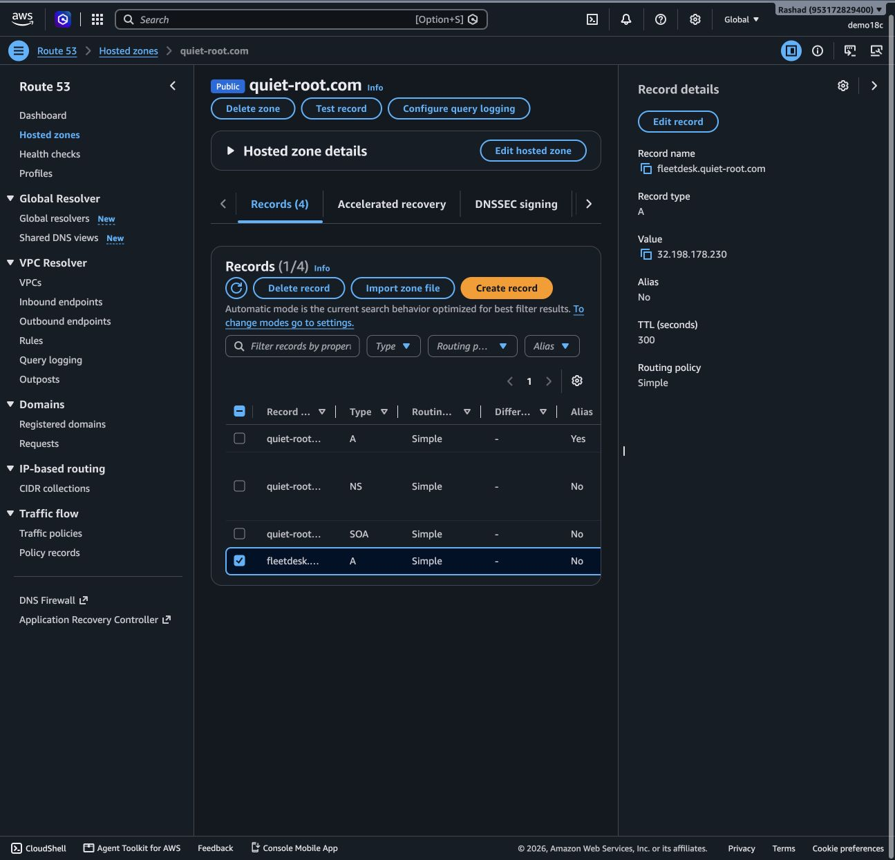
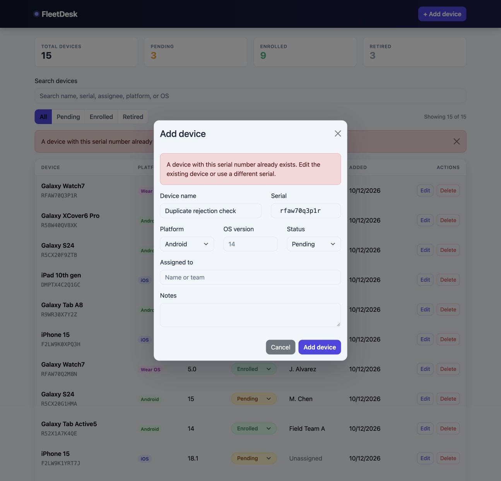

# FleetDesk — ITMD 504 final project

**Author:** Rashad Abdulbarr  
**Course:** Programming and Application Foundations  
**Evidence dates:** October 27 and November 15, 2026

## Required URLs

- Functional cloud application: https://fleetdesk.quiet-root.com
- Source control: https://github.com/demo18c/fleetdesk

## Submission index

| Assignment requirement | Where to look |
|---|---|
| Source code | [Frontend entry point](../client/src/App.jsx) and [backend routes](../server/routes/devices.js) |
| Explanation of frameworks | [Frameworks used](#frameworks-used) |
| Database schema | [Database Schema](#database-schema) and [Mongoose model](../server/models/Device.js) |
| Deployment pipeline | [Deployment pipeline](#deployment-pipeline) and [GitHub Actions workflow](../.github/workflows/deploy.yml) |
| Testing strategy | [Testing strategy and evidence](#testing-strategy-and-evidence) and [verification results](verification.md) |
| User stories and requirements | [User stories and acceptance criteria](user-stories.md) |
| Mockup or wireframes | [Inventory and device form wireframes](wireframes.md) |

## Purpose and requirements

FleetDesk supports a small IT or field-support team managing phones, tablets, watches, and Windows devices. Administrators need to list inventory, register devices, update assignments and enrollment status, search records, and remove retired inventory. The [user stories](user-stories.md) contain acceptance criteria for these workflows.

## Transcript requirements mapped to implementation

| Requirement | Implementation and evidence |
|---|---|
| Public functional cloud URL | HTTPS app on AWS EC2; application screenshot below |
| Frontend frameworks and styling | React, Vite, Bootstrap and custom CSS in `client/src` |
| Server logic and client API consumption | Express routes in `server/routes/devices.js`; browser fetch functions in `client/src/api.js` |
| Database and matching records | MongoDB Atlas `fleetdesk.devices`; screenshot below shows the same names and serials as the application |
| Dynamic retrieval and updates | GET, POST, PUT and DELETE; edit modal and inline status control |
| Source control | Public repository linked above; incremental commits |
| User requirements | Ten documented user stories with acceptance criteria |
| Continuous deployment | GitHub Actions builds on push to main, then deploys over SSH, rebuilds on EC2 and restarts PM2 |
| User experience | Responsive table, platform badges, status filters, search, required fields, error feedback and delete confirmation |

## Frameworks used

- **React** renders the inventory and device editor, and manages search and status filters.
- **Bootstrap and React Bootstrap** provide the table, form, and modal styling alongside project CSS.
- **Vite** runs the frontend development server and builds the frontend for deployment.
- **Express** serves the React build and handles the REST API. Caddy proxies public HTTPS requests to Express.
- **Mongoose** defines device fields and validation and connects the Express API to MongoDB Atlas.

## Database Schema

**MongoDB collection:** `fleetdesk.devices`. See the [schema source](../server/models/Device.js) and [MongoDB Atlas screenshot](screenshots/atlas-devices.jpg).

| Field | Type | Rule or default |
|---|---|---|
| `name` | String | Required, trimmed, up to 80 characters |
| `serial` | String | Required, unique, trimmed and uppercased, up to 64 characters |
| `platform` | String | `android`, `ios`, `wearos`, or `windows`. Defaults to `android` |
| `osVersion` | String | Optional, up to 32 characters |
| `status` | String | `pending`, `enrolled`, or `retired`. Defaults to `pending` |
| `assignedTo` | String | Optional, up to 80 characters |
| `notes` | String | Optional, up to 1,000 characters |
| `_id` | ObjectId | MongoDB document identifier |
| `createdAt`, `updatedAt` | Date | Set automatically by Mongoose |

Serials are trimmed and converted to uppercase before storage. A unique database index prevents duplicate serials on both creation and update, including simultaneous requests. Conflicts return HTTP 409 and a readable message inside the form. Other schema validation errors return HTTP 400. The server waits for index initialization before opening its port.

Search filters loaded records without changing the database, ignores case and surrounding whitespace, and works together with the status filter. It searches name, serial, assignee, platform and OS version.

Visitors can view and edit the demo inventory without signing in. The device API applies per-client rate limits and validates writes before saving them.

## Application and database evidence

Match `Galaxy Watch7` / `RFAW70Q3P1R`, `Galaxy XCover6 Pro` / `R58W40QV8XK`, and `Galaxy S24` / `R5CX20F9ZTB` between the app and Atlas screenshots. The app sorts newest first; Atlas's table order differs. Dates in the app use the browser timezone, while Atlas stores UTC timestamps.

## Deployment pipeline

The [GitHub Actions workflow](../.github/workflows/deploy.yml) runs on pushes to `main`. It installs the locked dependencies and builds the frontend. After the build passes, the workflow connects to EC2 over SSH and runs the [deployment script](../deploy/deploy.sh), which updates the checkout, rebuilds the app, and restarts it under PM2.

[Public demo deployment run](https://github.com/demo18c/fleetdesk/actions/runs/43723115899) shows the deployment that opened the demo without an access key.

[Successful search/unique-serial deployment](https://github.com/demo18c/fleetdesk/actions/runs/40514259850). Both Build check and Deploy over SSH succeeded.

## Reviewer walkthrough

1. Open the public app and wait for the inventory to load.
2. Search for `RFAW70Q3P1R`; one Galaxy Watch7 should appear. Search ignores letter case.
3. Choose Enrolled while that search is active; no records match. Return to All and clear search to restore the full device list.
4. Open Edit to inspect the pre-filled fields. Cancel leaves data unchanged.
5. To test duplicate prevention without creating a record, use Add device with a name and existing serial `RFAW70Q3P1R`. The form should explain that the serial already exists. Cancel afterward.
6. For CRUD demonstration, create a clearly labeled demo device with a new serial, edit it, then refresh to confirm persistence. Keep demonstration records separate from the original inventory.

## Cloud hosting and DNS evidence

The AWS console confirms the FleetDesk `t3.small` instance is Running with Elastic IP `32.198.178.230`. Route 53 has a simple A record for `fleetdesk.quiet-root.com` pointing to that same address, with TTL 300 seconds.

Keep the app running through the instructor's grading period; the supplied transcript does not specify an exact duration.

## Interface wireframes

See the [inventory and device form wireframes](wireframes.md).

## Testing strategy and evidence

The checks cover the production build, live browser workflows, API responses, and database persistence. See the [verification log](verification.md) for recorded results.

| Area | What to check | Evidence |
|---|---|---|
| Inventory and search | Load the inventory, search by serial, and combine search with a status filter | [Search result](screenshots/app-search.jpg) |
| Create, update, and delete | Use a disposable record and refresh after an update to check persistence | [Created](screenshots/crud-3-created.jpg), [updated](screenshots/crud-5-updated.jpg), [deleted](screenshots/crud-6-deleted.jpg) |
| Duplicate prevention | Try an existing serial and confirm the form reports the conflict | [Duplicate warning](screenshots/duplicate-serial.jpg) |
| Database | Match sample names and serials between the browser and Atlas | [Atlas collection](screenshots/atlas-devices.jpg) |

The live CORS check confirmed that the API advertises the FleetDesk origin in its response. See the [CORS header capture and test results](verification.md#cors-verification--november-15-2026).
